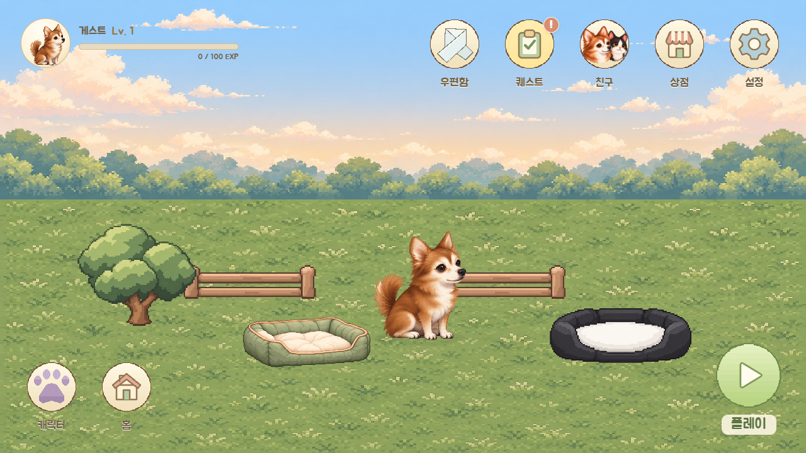
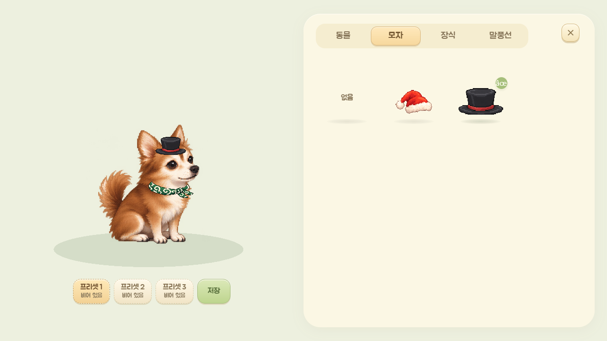
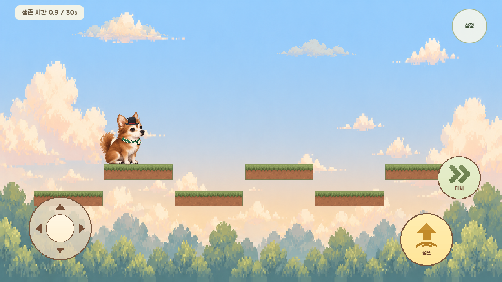
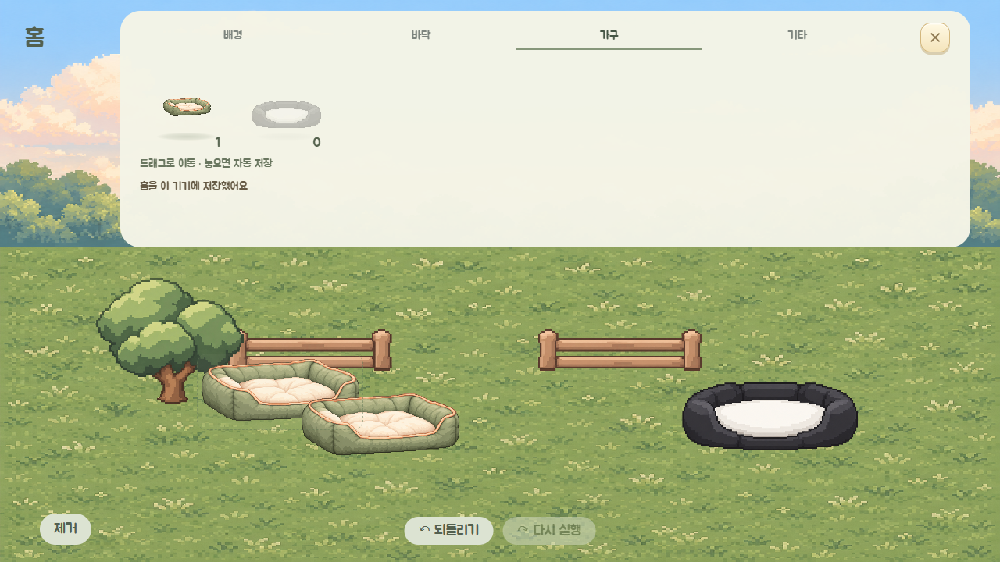
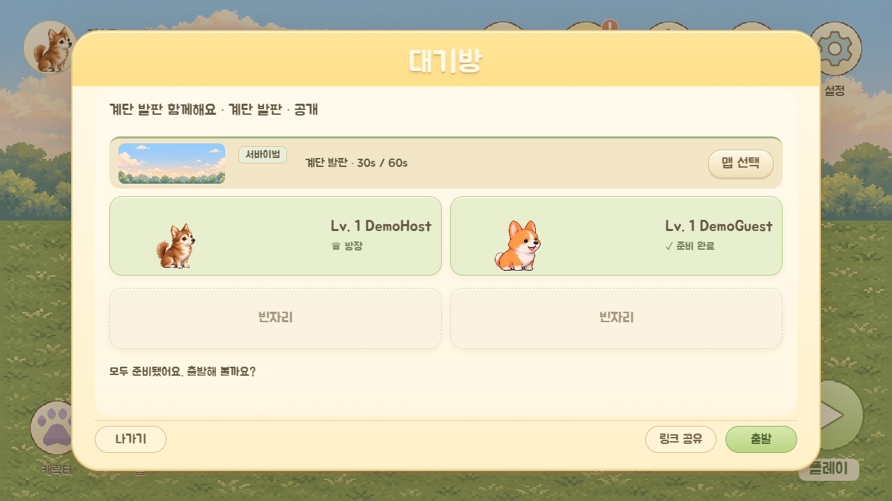
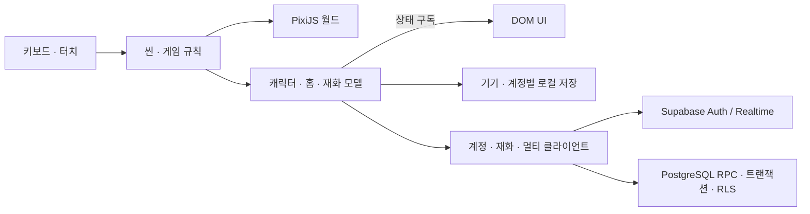

# PawHaven

**돌아오면 반겨주는 작은 친구들.**

반려동물과 교감하고, 나만의 공간을 꾸미고, 짧은 게임을 함께 즐기는 **2D 픽셀 아트 웹 게임**입니다. 함께 지냈던 반려견 **명랑이**를 게임 속에 담고 싶다는 생각에서 출발했습니다.

**[게임 플레이](https://genjiboy0312.github.io/PawHaven/) · [구현·검증 문서](MyAIAgent) · [프로젝트 기획](MyAIAgent/PAW_HAVEN_PROJECT.md)**

개인 프로젝트 · 기획/개발 · AI 지원 제작 · 웹/PWA 프로토타입

기술: **TypeScript · PixiJS 8 · Vite · Supabase · PostgreSQL**



## 먼저 확인할 세 가지

- **기획:** 교감 → 짧은 플레이 → 보상 → 꾸미기 → 다른 유저와의 만남이 연결되는 경험을 구성했습니다.
- **개발:** 캐릭터·착용·맵·입력·UI를 공용 컴포넌트로 재사용하고, 상태 구독으로 화면을 갱신합니다. 같은 생존 규칙으로 평지·계단 서바이벌을 구성했습니다.
- **검증:** 계정 저장 충돌, 구매 응답 유실, 멀티 출발 시각처럼 실제 플레이에서 발견한 문제를 회귀 테스트로 남겼습니다. 현재 CI 전체 대상은 **441개 테스트**입니다. *(2026-11-07 기준)*

## 3분 플레이 가이드

1. 타이틀을 터치하고 로비의 동물을 눌러 대사·이모션을 확인합니다.
2. **상점 → 펫 → 강아지**에서 명랑이를 구매한 뒤 **캐릭터 → 동물**에서 선택합니다. 게스트는 기본 프로토타입 코인으로 체험할 수 있습니다.
3. **홈**에서 가구를 배치하고 드래그한 뒤 Undo/Redo를 사용합니다. 놓은 위치는 자동 저장됩니다.
4. **플레이 → 싱글 → 맵 변경**에서 **레이스 / 서바이벌**을 선택합니다. 계단 발판은 30초 생존을 목표로 합니다.
5. 로그인 후에는 **멀티플레이·공원·친구·우편함**과 계정 간 저장을 이용할 수 있습니다.

PC는 키보드, 모바일은 화면 조이스틱과 버튼을 사용합니다. 16:9 가로 화면을 기준으로 하며, 세로 모바일에서는 게임 영역을 회전해 배치합니다.

| 조작 | PC | 모바일 |
| --- | --- | --- |
| 이동 | A / D 또는 ← / → | 조이스틱 |
| 점프 | Space / W / ↑ | Jump |
| 지상 대시 | Shift | Dash |
| 공격 | J | Attack — 레이스에서 사용 |

공원에서는 조이스틱으로 바닥 영역의 상하좌우 이동도 지원합니다. 설정에서 버튼 크기·위치와 한국어/영어를 바꿀 수 있습니다.

## 플레이 화면

스크린샷은 명랑이를 선택한 로컬 촬영 프로필의 **실제 실행 화면**입니다. 멀티 대기방은 로컬 PostgreSQL과 `DemoHost`·`DemoGuest` 테스트 계정으로 구성했습니다.

<table>
  <tr>
    <td width="50%"><br><strong>캐릭터 꾸미기</strong> — 공용 착용 레이어와 프리셋 3개</td>
    <td width="50%"><br><strong>계단 서바이벌</strong> — 이동·점프·대시와 공통 시간 규칙</td>
  </tr>
  <tr>
    <td><br><strong>홈 편집</strong> — 다중 배치·자동 저장·3단계 Undo/Redo</td>
    <td><br><strong>멀티 대기방</strong> — 방장 맵 선택·참가자 Ready·외형 공유</td>
  </tr>
</table>

## 현재 구현 범위

| 영역 | 구현 내용 |
| --- | --- |
| 교감·캐릭터 | 코기·명랑이·턱시도 고양이, 행동별 애니메이션, 자율 이동·휴식·수면, 터치 대사·이모션·간식 반응 |
| 캐릭터 꾸미기 | 모자·장식·말풍선 스킨, 구매 전 미리보기·구매 후 착용, 공용 프리셋 3개, 로비·게임·대기방 외형 공유 |
| 홈 꾸미기 | 시간대별 하늘·벚꽃 하늘·바닥, 펫 소파·펫하우스·나무·울타리·상자, 보유 수량 기반 다중 배치, 드래그·자동 저장·Undo/Redo |
| 레이스 | 싱글 맵 5종, 그중 멀티 지원 3종. 발판·틈·체크포인트·공격용 상자·뱀·코인, 완주 보상·재도전, 개인 최고 기록·달성 목표 |
| 서바이벌 | 평지·계단 맵 2종. 싱글 30초, 최대 4인 멀티 60초, 발판 경고·소멸·복구, 탈락 후 관전·최후 생존자·공동 우승 |
| 멀티플레이 | 2×2 방 목록·페이지 전환·새로고침, 공개/초대 전용 방, 방장 맵 선택·Ready·공통 카운트다운, 위치 보간·닉네임·레이스 잠정 순위·결과 연출·대기방 채팅 |
| 소셜·공원 | 4개 공원 채널과 시간대별 배경, 이동·점프·채팅·말풍선·귓속말, 친구 요청·활동·방 초대·차단/해제·친구 홈 방문 |
| 계정·성장 | Google/이메일 로그인, 최초 닉네임 설정, 계정 레벨·EXP·레벨업 보상, 꾸미기 저장과 싱글 기록의 계정 동기화 |
| 상점·보상 | 펫·꾸미기·로비 상품, 일일 퀘스트·시즌패스 프로토타입, 완주 코인·간식, 출석 우편·쿠폰 입력·보상 수령·중복 방지 |
| 기기 대응 | 한영 UI, 음량·화면 효과·입력 설정, 버튼 배치 편집, 브라우저 뒤로 가기·앱 복귀·연결 복구, 지원 브라우저의 PWA 설치 요청 |

코기가 기본 동물이며 명랑이·고양이와 추가 상품은 구매 후 사용합니다. 게스트의 로컬 재화와 로그인 계정의 서버 재화는 분리합니다. **서바이벌은 현재 코인·EXP 보상이 없는 프로토타입**입니다. 광고·현금 결제·스토어용 네이티브 앱 배포는 아직 포함하지 않습니다.

## 기획과 개발에서 중요하게 본 것

### 1. 콘텐츠를 추가할 때 공통 자원을 다시 사용하기

동물을 추가할 때마다 UI와 게임 규칙을 새로 만들지 않도록 `AnimalConfig`와 공용 애니메이션·착용 계층을 사용합니다. 맵은 `CourseCatalog.mode`로 분류하고, 맵 선택의 게임 종류 탭도 싱글·방 생성·방장 선택창에서 공유합니다.

평지와 계단 서바이벌은 발판 데이터만 다르고 이동 물리·시간 패턴·관전·결과 처리를 공유합니다. 홈의 Undo/Redo는 편집 기록 컴포넌트로 분리하고, 기존 저장 경로를 재사용합니다. 새 기능의 구현 비용과 이후 유지보수 범위를 함께 고려한 선택입니다.

[AnimalConfig](src/animals/AnimalConfig.ts) · [SurvivalArena](src/game/SurvivalArena.ts) · [GameModeTabs](src/ui/GameModeTabs.ts) · [HomeHistory](src/home/HomeHistory.ts)

### 2. 저장 데이터의 성격에 맞춰 충돌을 처리하기

캐릭터·홈 꾸미기는 서로 다른 기기의 편집이 충돌할 수 있어 **revision 비교 후 덮어쓰기를 멈추고 변경을 보존**합니다. 반면 최고 기록은 더 빠른 시간을, 달성 목표는 양쪽에서 얻은 항목을 합치는 **단조 병합**을 사용합니다.

게스트 기록은 사용자 확인 후 가져오고 계정별 저장 공간을 구분합니다. 구독·요청을 정리해 계정 전환 후 도착한 이전 응답이 새 계정에 적용되지 않도록 처리합니다.

[AccountService](src/account/AccountService.ts) · [SingleRecordSync](src/account/SingleRecordSync.ts) · [기록 동기화 설계](MyAIAgent/SINGLE_RECORD_SYNC.md)

### 3. 멀티의 출발과 월드 규칙을 같은 시간에 맞추기

참가자가 화면을 준비했다는 `loaded` 응답을 모두 보낸 후 서버가 공통 출발 시각을 정합니다. 위치 표시는 actor별 Supabase Realtime 비공개 채널과 보간을 사용하고, 연결 상태에 따라 서버 Broadcast/RPC 경로를 함께 사용합니다.

서바이벌 발판은 매번 소멸 이벤트를 전송하는 대신 **공통 시작 시각과 같은 시간 함수**로 계산합니다. 서버는 참가 권한·라운드·탈락 시각·최후 생존자·제한 시간의 결과를 확인합니다.

[RoomClient](src/multiplayer/RoomClient.ts) · [RoomStream](src/multiplayer/RoomStream.ts) · [RemoteMotion](src/multiplayer/RemoteMotion.ts) · [서바이벌 설계·검증](MyAIAgent/SURVIVAL.md)

### 4. 구매 응답이 유실돼도 한 번만 차감하기

로그인 계정의 가격·잔액·소유권·보상 조건은 PostgreSQL RPC에서 결정합니다. 요청 UUID와 처리 결과를 보관하고 같은 번호로 재시도하므로, 응답이 유실된 구매를 다시 보내도 중복 차감하지 않습니다. 완주 보상도 계정에 귀속된 플레이 토큰과 중복 지급 검사를 사용합니다.

기기 재화나 게스트 소유 목록을 서버 재화로 업로드하지 않습니다. 개인 기록 동기화도 보상 판정과 분리합니다.

[EconomyClient](src/shop/EconomyClient.ts) · [ServerShopState](src/shop/ServerShopState.ts) · [재화·보상 문서](MyAIAgent/SERVER_ECONOMY.md)

### 5. 픽셀 아트와 모바일 입력의 일관성 유지하기

Idle·달리기·공격 프레임의 외곽 크기가 달라 동작 전환 때 몸체가 커 보이는 문제를 수정했습니다. 표시 크기와 발 기준점을 맞추고, 모자·목 장식은 동물/동작별 부착점으로 보정해 공용 아이템을 재사용합니다.

PixiJS 월드와 DOM UI를 나누고 Pointer Events로 조이스틱·버튼의 동시 입력을 처리합니다. 씬 종료·앱 전환 때 입력과 구독을 해제하며, 모바일 키보드가 열린 경우 채팅 UI를 가시 영역에 맞춰 배치합니다.

[AnimalAnimationController](src/animals/AnimalAnimationController.ts) · [착용 맞춤 설계](MyAIAgent/ATTACHMENT_FITTING.md) · [모바일·복귀 처리](MyAIAgent/APP_RECOVERY.md)

## 기술 구조

| 구분 | 기술·역할 |
| --- | --- |
| 언어·빌드 | TypeScript · Vite |
| 게임 월드 | PixiJS 8 · 스프라이트/공유 텍스처 · 렌더러와 분리한 물리 모델 |
| UI·입력·사운드 | HTML/CSS 오버레이 · 상태 구독 · Pointer Events · @pixi/sound |
| 서버 | Supabase Auth/Realtime · PostgreSQL RPC·트랜잭션·RLS |
| 검증 | Node.js Test Runner · 실제 migration을 실행하는 PGlite · Playwright/Chrome |
| 배포 | GitHub Actions → GitHub Pages · 배포 파일 검증·공개 사이트 시작 검사 |



## 실행과 검증

Node.js 지원 범위는 [package.json의 engines](package.json)를 따릅니다.

```bash
git clone https://github.com/genjiboy0312/PawHaven.git
cd PawHaven
npm ci
npm run dev
```

기본 주소는 `http://localhost:5173/`입니다. Supabase 설정 없이 게스트 모드로 실행할 수 있습니다. 계정 기능은 `.env.example`을 `.env.local`로 복사하고 본인 프로젝트의 URL과 publishable key를 설정합니다. SQL 적용·Google Provider·Redirect URL은 [Supabase 연동 문서](MyAIAgent/SUPABASE.md)와 [migration 폴더](supabase/migrations)를 참고해 주세요. secret/service_role 키는 프런트엔드에 넣지 않습니다.

```bash
npm test           # package.json에 등록된 기본 회귀 테스트
npm run typecheck  # TypeScript 검사
npm run build      # 타입 검사 + 프로덕션 빌드
npm run preview    # 빌드 결과 확인
```

**CI는 `tests/*.test.mjs` 전체를 실행**합니다. 현재 441개 테스트는 이동·충돌·생존 규칙, 계정 분리/충돌, RPC/RLS 권한, 구매·보상 중복 방지, 친구·초대·차단, 입력 수명과 UI 회귀를 포함합니다. 최신 테스트 파일 일부는 `npm test` 기본 목록과 별도로 CI에서 실행됩니다.

main에 푸시하면 전체 테스트 → 타입 검사·빌드 → 구매 후 재접속 검사 → Pages 배포 → 배포 파일 검증 → 공개 사이트 시작 검사를 실행합니다. [배포 실행 기록](https://github.com/genjiboy0312/PawHaven/actions)

로컬 DB·모의 transport·브라우저 viewport 검증과 **운영 Supabase 다계정·실제 모바일 기기 검증은 구분**합니다. 이동 물리와 서바이벌 낙하는 클라이언트가 계산/보고하므로, 서버 권위 물리 시뮬레이션이나 완전한 부정행위 방지까지 구현한 상태는 아닙니다. 현재 멀티의 잠금·전송 구조도 소규모 프로토타입 기준입니다.

## 디렉터리와 상세 문서

```text
src/
  animals/       동물 설정 · 애니메이션 · 착용 · 교감
  game/          씬 · 물리 · 카메라 · 레이스/서바이벌 맵
  home/          배치 모델 · 편집 기록 · 공용 맵 렌더러
  account/       인증 · 계정 저장 · 기록 병합 · 연결 복구
  multiplayer/   방 · 공통 시각 · 위치 전송/보간
  park/ friends/ mail/   소셜 공간 · 관계 · 우편/보상
  shop/          로컬/서버 경제 · 구매/보상 요청 큐
  settings/ ui/  설정 · 한영 문구 · DOM 공용 컴포넌트
public/assets/   실제 배포용 아트 · 폰트 · 아이콘
Resources/       제작 원본 리소스
supabase/        계정·재화·게임·소셜 migration
tests/           게임 규칙 · UI · 실제 SQL 회귀 테스트
MyAIAgent/       기획·설계·검증 기록 · README 스크린샷
```

[교감 대사](MyAIAgent/HEALING_DIALOGUE.md) · [홈 편집](MyAIAgent/HOME.md) · [멀티플레이](MyAIAgent/MULTIPLAYER.md) · [공원](MyAIAgent/PARK.md) · [친구](MyAIAgent/FRIENDS.md) · [우편함](MyAIAgent/MAILBOX.md) · [PWA 설치](MyAIAgent/PWA_INSTALL.md)

## 현재 범위와 개선 과제

- 레이스·서바이벌의 조작 난이도와 맵 밸런스, 실제 모바일 가독성·키보드 동작을 계속 검증합니다.
- 운영 다계정에서 저장·구매·보상 연속성과 네트워크 지연/재접속을 확인하고, 규모 확장 전 서버 권위와 전송 구조를 보완할 계획입니다.
- 광고·결제·네이티브 앱 패키징은 운영 정책과 검증 범위를 정리한 뒤 검토할 후속 범위입니다. 현재 공개 결과물은 웹/PWA입니다.

## 제작 방식과 리소스

제작자가 기획·우선순위·아트 방향과 반복 플레이 피드백을 결정하고, **코드·테스트·문서·아트 제작에 AI 도구를 활용**했습니다. 기능별 구현 결정과 검증 범위는 `MyAIAgent`에 기록합니다. README는 확인 가능한 현재 구현을 기준으로 작성했습니다.

Jua 폰트를 자체 배포하며 동봉 폰트의 OFL 라이선스는 [폰트 폴더](public/assets/fonts)에 포함되어 있습니다. 프로젝트 공개가 캐릭터·아트 리소스의 무제한 재사용 허가를 의미하지는 않습니다.

피드백: [genjiman0312@gmail.com](mailto:genjiman0312@gmail.com)
