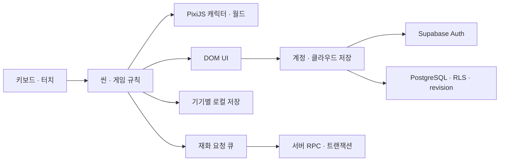

# PawHaven

**돌아오면 반겨주는 작은 친구들.**

반려동물과 교감하고, 캐릭터와 집을 꾸미고, 짧은 플랫폼 코스를 즐기는 웹 게임입니다. 함께했던 반려견 **명랑이**를 픽셀 캐릭터로 담는 데서 출발해, 로비의 작은 반응부터 계정별 저장까지 이어지는 경험을 만들고 있습니다.

**[게임 플레이](https://genjiboy0312.github.io/PawHaven/) · [개발 현황](MyAIAgent/DEVELOPMENT_PLAN.md) · [프로젝트 기획](MyAIAgent/PAW_HAVEN_PROJECT.md)**

현재 공개 버전은 개발 중인 프로토타입입니다. 로그인 없이 로컬 플레이를 시작할 수 있으며, Google 로그인 시 계정별 저장과 서버 재화를 사용합니다.

## 빠르게 둘러보기

1. 타이틀을 터치하고 로비에서 강아지를 눌러 대사와 반응을 확인합니다.
2. **Character**에서 코기/명랑이와 모자를 선택하고, 프리셋을 저장합니다.
3. **Home**에서 배경·바닥을 바꾸고 가구를 드래그해 배치합니다.
4. **Play**에서 발판과 틈을 넘고, 상자를 공격한 뒤 피니시까지 달립니다.
5. **Quest / Shop**에서 보상과 아이템 구매 흐름을 확인합니다.

PC는 키보드, 모바일은 화면 조이스틱과 버튼을 사용합니다. 게임 화면은 16:9이며, 세로 모바일 화면에서는 게임 영역을 회전해 가로 배치합니다.

| 조작 | PC | 모바일 |
| --- | --- | --- |
| 이동 | A / D 또는 ← / → | 좌측 조이스틱 |
| 점프 | Space / W / ↑ | Jump |
| 대시 | Shift, 지상에서 사용 | Dash |
| 공격 | J, 공중에서도 사용 | Attack |

## 구현한 기능

| 영역 | 현재 구현 |
| --- | --- |
| 반려동물 | 코기·명랑이, 자율 이동과 휴식, 터치 반응·힐링 대사, 행동별 애니메이션 |
| 캐릭터 꾸미기 | 동물 선택, 공용 프리셋 3개, 산타모자 착용과 로비·플레이 연동 |
| 집 꾸미기 | 배경·바닥 선택, 가구/기타 아이템의 수량·다중 배치·드래그 이동 |
| 플랫폼 코스 | 정상 주행 기준 약 20~30초, 발판·틈, 체크포인트, 공격용 상자, 완주 기록·재도전 |
| 설정 | 음량, 조작 배치, 화면 효과, 한국어·영어, 계정, 피드백 안내 |
| 모드·멀티 | 싱글 맵 3종·맵 카드·계정별 로컬 최고 기록, 2×2 방 페이지, 최대 4인·방장 맵 선택·Ready·카운트다운·순위 |
| 계정 저장 | Google / 이메일 로그인, 최초 닉네임 설정, 꾸미기 클라우드 저장, 충돌 감지·재시도 |
| 재화 | 서버 검증 구매, 일일 퀘스트·프로토타입 시즌패스 보상, 중복 요청 방지 |

**프로토타입 범위:** Friends는 UI 더미이며, 일부 꾸미기 아이템은 임시 표현입니다. 시즌패스 해금은 무료 테스트용으로 실제 결제를 하지 않습니다. 광고·결제는 아직 구현하지 않았습니다. 멀티 레이스는 새 SQL 적용이 필요한 소규모 프로토타입이며, 이동 물리는 클라이언트에서 계산합니다.

## 기술 구성

| 구분 | 사용 기술 |
| --- | --- |
| 언어·빌드 | TypeScript, Vite |
| 게임 렌더링 | PixiJS 8, 스프라이트 애니메이션, 공용 텍스처/VFX |
| UI·입력 | HTML/CSS 오버레이, Pointer Events, 키보드 입력 |
| 사운드 | @pixi/sound |
| 인증·데이터 | Supabase Auth, PostgreSQL, RLS, RPC |
| 테스트 | Node.js Test Runner, PGlite |
| 배포 | GitHub Actions → GitHub Pages |



## 설계와 문제 해결

### 애니메이션을 바꾸면 캐릭터가 커 보이는 문제

앉은 Idle과 달리는 프레임은 외곽 크기가 달라서, 프레임 높이만 맞추면 동작 전환 시 몸체가 커졌습니다. 승인된 Idle의 표시 크기를 기준으로 몸체 면적을 측정해 클립별 배율을 보정하고, 발 기준점과 논리 캔버스를 맞췄습니다. 몸체·모자·잔상이 같은 변환을 따르도록 구성했습니다.

관련 코드: [AnimalAnimationController](src/animals/AnimalAnimationController.ts) · [명랑이 제작 기록](MyAIAgent/MYEONGRANG_ANIMATION.md)

### 모바일 입력과 씬 수명 분리

캐릭터는 PixiJS로 그리되, 로비의 터치 영역과 메뉴는 DOM으로 관리합니다. 애니메이션 프레임마다 터치 범위가 달라지는 문제를 줄이고, 씬 종료 시 이벤트·포인터 캡처·UI를 정리합니다. 조이스틱과 버튼은 동시에 사용할 수 있고, 앱 전환·일시정지 시 입력을 해제합니다.

관련 코드: [LobbyScene](src/game/scenes/LobbyScene.ts) · [PlayScene](src/game/scenes/PlayScene.ts)

### 다른 기기의 저장을 덮어쓰지 않기

게스트와 로그인 계정의 로컬 데이터를 분리하고, 꾸미기 저장에 revision 비교를 적용했습니다. 서버에 더 최신 저장이 있으면 자동 덮어쓰기를 멈추고 로컬 변경을 보관합니다. 불러오기 응답을 기다리는 도중 발생한 새 편집도 보존합니다. 저장 대기·완료·실패를 구분해 표시합니다.

관련 코드: [AccountService](src/account/AccountService.ts) · [계정 SQL](supabase/migrations/202610170001_player_accounts.sql)

### 클라이언트 코인을 신뢰하지 않는 구매·보상

로그인 계정의 가격·잔액·보상 조건은 서버에서 결정합니다. 사용자별 잠금과 트랜잭션으로 처리하며, 요청 UUID를 재사용해 응답이 유실된 구매도 중복 차감 없이 재시도합니다. 완주 기록은 계정에 귀속된 1회성 플레이 토큰을 사용합니다.

이 검증은 기본적인 재화 보호 범위입니다. 이동·물리 자체는 클라이언트에서 실행하며, 서버 권위 게임 시뮬레이션이나 완전한 부정행위 방지를 구현한 상태는 아닙니다.

관련 코드: [EconomyClient](src/shop/EconomyClient.ts) · [재화 SQL](supabase/migrations/202610170002_server_economy.sql) · [서버 재화 설계](MyAIAgent/SERVER_ECONOMY.md)

### 방과 레이스 프로토타입

로그인한 사용자끼리 방을 만들고, 방원 전원 Ready 후 서버 시각에 맞춰 출발합니다. 입장 정원·방장 권한·라운드·완주 순위는 서버 RPC에서 검증합니다. 표시용 위치는 본인만 송신 가능한 actor별 private WebSocket으로 전달하고 짧은 스냅샷 보간으로 표시합니다. 방·완주 검증은 RPC에 유지하며 직접 연결 실패 시 서버 Broadcast/RPC로 동작합니다. 전역 잠금을 쓰는 소규모 검증용 구현이며, 서비스 규모의 전송 구조·서버 권위 물리는 후속 범위입니다. 멀티 보상은 이번 버전에서 추가하지 않았습니다.

서버 적용/검증 범위: [멀티 레이스 문서](MyAIAgent/MULTIPLAYER.md) · [멀티 SQL](supabase/migrations/202610190003_multiplayer.sql) · [실시간 수신 SQL](supabase/migrations/202610200004_room_stream.sql) · [직접 위치 전송 SQL](supabase/migrations/202610200005_direct_motion.sql) · [대기방 알림 SQL](supabase/migrations/202610200006_lobby_state.sql) · [화면 준비·카운트다운 SQL](supabase/migrations/202610200007_race_countdown.sql)

## 로컬 실행

Node.js **22 LTS**를 권장합니다. 지원 범위는 package.json의 engines를 따릅니다.

```bash
git clone https://github.com/genjiboy0312/PawHaven.git
cd PawHaven
npm ci
npm run dev
```

기본 주소는 `http://localhost:5173/`입니다. 환경 변수가 없으면 게스트 모드로 실행됩니다.

계정 기능을 사용하려면 `.env.example`을 `.env.local`로 복사하고 **본인 Supabase 프로젝트의 URL과 publishable key**를 설정합니다. migration 실행과 Google Provider/Redirect URL 설정은 [연동 문서](MyAIAgent/SUPABASE.md)를 참고해 주세요. Secret/service_role 키는 프런트엔드에 넣지 않습니다.

## 검증과 배포

```bash
npm test           # 게임 규칙 · 저장 · 경제/RLS 회귀 테스트
npm run typecheck  # TypeScript 검사
npm run build      # 타입 검사 + 프로덕션 빌드
npm run preview    # 빌드 결과 로컬 확인
```

현재 자동 테스트 **161개**를 운영합니다. 이동·점프·대시 충돌, 체크포인트·결과창, 씬 복귀 후 입력, 계정 분리·저장 충돌, 구매·보상의 재시도를 검증합니다. PGlite에서는 실제 migration을 실행해 PostgreSQL 함수와 RLS를 테스트합니다. 모의 DOM/DB 테스트가 실제 Google 로그인이나 모바일 브라우저의 시각 검증을 대체하지는 않습니다.

main 브랜치에 푸시하면 GitHub Actions가 의존성 설치 → 테스트 → 타입 검사·빌드 → GitHub Pages 배포를 실행합니다.

## 디렉터리

```text
src/
  animals/       캐릭터 · 애니메이션 · 착용 · VFX
  game/          씬 · 카메라 · 플랫폼 물리 · 코스 데이터
  home/          집 배치와 저장 모델
  account/       인증 · 계정별 저장 · 동기화
  shop/          로컬/서버 재화 모델 · 요청 큐
  settings/      환경 설정 · 한국어/영어
  ui/            DOM 메뉴 · 팝업 · 공용 테마
public/assets/   배포용 픽셀 아트 · 폰트
supabase/        계정/재화 migration
tests/           게임 · 계정 · 실제 SQL 회귀 테스트
MyAIAgent/       기획 · 구현 결정 · 작업/검증 기록
```

## 다음 단계

- PC와 모바일에서 같은 계정의 저장·구매·보상 연속성 확인
- 코스의 장애물·카메라·재도전 동선에 대한 실기기 조작감 개선
- 아이템 아트 확장과 꾸미기 UI 정리
- 친구 기능, 광고 보상, 결제는 계정·운영 정책을 정리한 뒤 단계적으로 검토

## 제작 및 리소스

AI 도구를 활용해 코드와 픽셀 아트를 제작하고, 실제 플레이 피드백을 바탕으로 수정한 프로젝트입니다. 설계·구현·검증 과정은 MyAIAgent 문서에 기록합니다. 반려견 원본 사진은 README에 포함하지 않습니다.

폰트는 Jua와 Gowun Dodum을 자체 배포하며, 각각의 OFL 라이선스는 [폰트 폴더](public/assets/fonts)에 포함되어 있습니다. 프로젝트 공개가 캐릭터·아트 리소스의 무제한 재사용 허가를 의미하지는 않습니다.

피드백: [genjiman0312@gmail.com](mailto:genjiman0312@gmail.com)
